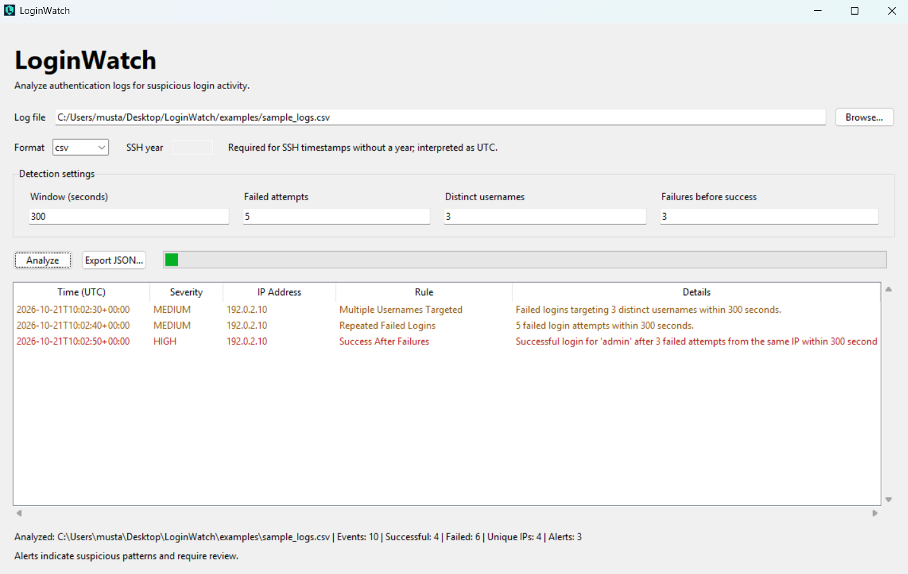

# LoginWatch

A desktop application and command-line tool for detecting suspicious login activity in CSV and OpenSSH authentication logs.

Choose a log file, review detected patterns, and export a JSON report.



## Features

- Windows desktop application with a file picker.
- CSV and OpenSSH authentication log support.
- IPv4 and IPv6 support.
- Configurable detection thresholds and time window.
- Alert table with severity, timestamps, IP addresses, and descriptions.
- JSON report export.
- Command-line interface for terminal users.

## Download and Run

[Download LoginWatch for Windows](https://github.com/bayazitm/LoginWatch/releases/latest)

The Windows executable is distributed through this repository's
**Releases** section.

1. Download `LoginWatch.exe` from a release.
2. Double-click the application.
3. Click **Browse...** and select your log file.
4. Choose `csv` or `ssh`.
5. For SSH timestamps without a year, enter the year.
6. Click **Analyze**.
7. Optionally click **Export JSON...** to save a report.

The packaged application includes its Python runtime.
A separate Python installation is not required.

## Example Results

Analyze `examples/sample_logs.csv` with the default settings:

```text
Events: 10
Successful logins: 4
Failed logins: 6
Unique IPs: 4
Alerts: 3
```

Analyze `examples/sample_auth.log` using SSH format and year `2026`:

```text
Events: 7
Successful logins: 2
Failed logins: 5
Unique IPs: 2
Alerts: 3
```

The example files contain synthetic events.

## Detection Rules

| Rule | Default trigger | Severity |
| --- | --- | --- |
| Repeated failed logins | 5 failures from one IP within 300 seconds | Medium |
| Multiple usernames targeted | Failed attempts targeting 3 distinct usernames from one IP within 300 seconds | Medium |
| Success after failures | A successful login after 3 failures for the same IP and username within 300 seconds | High |

Events are sorted chronologically before analysis.
The time window includes its exact boundary.

The first two rules produce at most one alert per IP per analysis.
A successful login resets the failure sequence for its IP and username.

Alerts identify suspicious patterns and require investigation.
They do not prove that an attack or account compromise occurred.

## Supported Formats

### CSV

Required columns:

```csv
timestamp,ip,username,success
2026-10-21T10:00:00+00:00,192.0.2.10,admin,false
2026-10-21T10:00:10+00:00,192.0.2.10,admin,true
```

- Column names are case-sensitive.
- Column order may vary.
- Extra columns are allowed.
- Timestamps must be accepted by Python's `datetime.fromisoformat`.
- Timestamps without a time zone are interpreted as UTC.
- `success` accepts `true` or `false`, case-insensitive.
- IPv4 and IPv6 addresses are validated.
- Invalid records stop analysis with an error.
- Files must use UTF-8 encoding; a UTF-8 BOM is supported.

### OpenSSH

Supported authentication messages include `Failed` and `Accepted`
events for:

- `password`
- `publickey`
- `keyboard-interactive`
- `keyboard-interactive/pam`

Traditional syslog example:

```text
Oct 21 10:02:00 server sshd[1234]: Failed password for invalid user admin from 192.0.2.10 port 50200 ssh2
```

Traditional timestamps require an explicit year and are interpreted
as UTC.

ISO timestamp example:

```text
2026-10-21T13:02:00+03:00 server sshd[1234]: Accepted publickey for alice from 2001:db8::1 port 50200 ssh2
```

ISO timestamps with a time zone offset are converted to UTC.

The parser supports `sshd` and `sshd-session` process names with
numeric process IDs in brackets.

Unrelated and unsupported messages are ignored. Analysis fails if
no supported authentication events are found.

## JSON Export

Reports include the input path, detection settings, event counts,
and alert details.

Choose a new output filename when exporting. Existing files are
not overwritten.

Reports can contain usernames, IP addresses, and local file paths.
Review reports before sharing them.

## Run from Source

Python 3.11 or newer is required. Tkinter is required for the desktop
interface and optional command-line file picker.

Download and extract the repository, then open a terminal in its folder.

### Windows

```powershell
py -m venv .venv
.\.venv\Scripts\python.exe -m pip install -e ".[dev]"
.\.venv\Scripts\python.exe -m loginwatch.gui
```

### Linux / macOS

```bash
python3 -m venv .venv
.venv/bin/python -m pip install -e ".[dev]"
.venv/bin/python -m loginwatch.gui
```

Tkinter availability depends on the Python installation.
The packaged `.exe` is for Windows.

## Command-Line Usage

### Analyze CSV

```powershell
.\.venv\Scripts\loginwatch.exe analyze examples/sample_logs.csv
```

### Analyze SSH logs

```powershell
.\.venv\Scripts\loginwatch.exe analyze examples/sample_auth.log --format ssh --year 2026
```

### Analyze a file from another folder

```powershell
.\.venv\Scripts\loginwatch.exe analyze "D:\Security Logs\logins.csv"
```

### Export JSON

```powershell
.\.venv\Scripts\loginwatch.exe analyze examples/sample_logs.csv --output reports/analysis.json
```

### Customize detection

```powershell
.\.venv\Scripts\loginwatch.exe analyze examples/sample_logs.csv --window 600 --failure-threshold 8 --username-threshold 4 --success-threshold 3
```

### Show help

```powershell
.\.venv\Scripts\loginwatch.exe analyze --help
```

On Linux or macOS, replace `.\.venv\Scripts\loginwatch.exe` with
`.venv/bin/loginwatch`.

## Tests

```powershell
.\.venv\Scripts\python.exe -m pytest -q
```

Tests cover detection thresholds, time windows, separation of users
and IP addresses, and supported SSH parsing behavior.

## Build the Windows Executable

Run on Windows from the repository folder:

```powershell
.\.venv\Scripts\python.exe -m pip install --upgrade pyinstaller
.\.venv\Scripts\python.exe -m PyInstaller --clean --noconfirm --onefile --windowed --name LoginWatch --paths src run_gui.py
```

The executable is created at:

```text
dist/LoginWatch.exe
```

## Limitations

- Local file analysis only; live monitoring is not implemented.
- Events are loaded into memory before analysis.
- Only the documented input formats are supported.
- Ignored SSH messages are not counted in the report.
- Traditional SSH timestamps use UTC and one supplied year for the
  entire file. Split files spanning a year boundary before analysis.
- Shared IP addresses, proxies, and legitimate retries may produce
  alerts.
- Activity below the configured thresholds may not produce alerts.
- The Windows executable has been manually checked on the development
  computer. Compatibility with other computers has not yet been verified.
